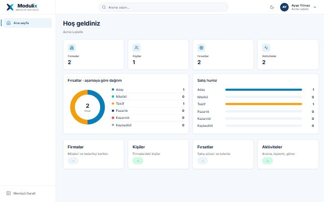

# Tasarım sistemi geçiş raporu — Faz 1

Tarih: 30.10.2026 · Dal: `tasarim-sistemi/faz-1`

Bu faz, Modulix tasarım sistemini **merkezi katmanlardan** (token, tema, kabuk, ortak CSS) kurar. Bütün sayfalar aynı ortak sınıfları kullandığı için yeni görünüm tek noktadan bütün ekranlara yansır. Ekrana özel yeniden düzenlemeler (fırsat hunisi, aktivite çekmecesi, DataGrid gibi) sonraki fazlara bırakıldı; aşağıda açıkça listelendi.

> Önizlemeler gerçek `app.css` ve layout CSS'iyle hazırlanmış statik bir HTML sayfasından alınmıştır (uygulama veritabanı olmadan bu ortamda çalıştırılamadı). Tablo ve sayılar örnek veridir.

## 1. Mevcut altyapı (envanter)

| Konu | Bulgu |
|---|---|
| Framework | .NET 10, Blazor WebAssembly (standalone), `Modulix.Web` yalnızca `Modulix.Shared`'a başvurur |
| UI kütüphanesi | Bootstrap 5.3.3 (yerel `wwwroot/lib`), ek bileşen kütüphanesi yok |
| Stil | `wwwroot/css/app.css` (~2.300 satır, `--mx-*` değişkenleri) + scoped `*.razor.css` (MainLayout, NavMenu) |
| Routing | `@page` yönlendirmeleri, Türkçe slug'lar; aktif modül route'tan `AppNavigation.Resolve` ile bulunur |
| Layout / navigation | `MainLayout`, `NavMenu`, `AppLauncher` (uygulama paneli), `PublicLayout` (oturumsuz teklif sayfası) |
| Form altyapısı | Elle yazılmış formlar (`record-form`, `form-grid`), `FieldError`, sunucu doğrulaması |
| Dinamik alanlar | `CustomFieldInputs` (özel alanlar), `Yönetim → Özel alanlar`, `Seçim listeleri` |
| Lookup | `LookupPicker` + `js/lookup.js`, aranabilir alanlar `Alan ve lookup ayarları` ekranından (metadata) |
| Grid | `table record-table` + `Pager`; telefonda kart listesi |
| Modal / drawer / toast | Yok; sayfa içi formlar ve `Notice` |
| Dashboard / grafik | `Home` istatistik kartları, `BarChart`, `DonutChart`, rapor sayfaları |
| Tema / tercih | Yoktu (bu fazda eklendi) |
| Tenant / platform ekranları | `Pages/Admin` (14), `Pages/Platform` (6) |

## 2. Ekran envanteri

57 Razor sayfası var. **Referans tasarımdaki Sözleşmeler, Siparişler, Destek Talepleri, Şikâyet, Onboarding, CRM Dashboard, Workflow, Entegrasyon, Form/View Designer ekranları uygulamada yoktur** ve raporda varmış gibi gösterilmez.

| Grup | Sayfalar | Ortak desen | Bu fazda |
|---|---|---|---|
| Kimlik (oturumsuz) | Giriş, Şifremi unuttum, Şifre sıfırla, E-posta onayı, Davet, Kuruluş seç | `narrow` kart | Token/tema, marka adı |
| Genel | Ana sayfa, Hesabım, Bulunamadı | `stat-card`, `settings-group` | Token/tema |
| CRM — liste | Firmalar, Kişiler, Leadler, Fırsatlar, Aktiviteler, Teklifler, Ürünler, Fiyat listeleri, Kategoriler, Birimler, İndirimler, Teklif kuralları, Onaylar, Vekâletler, Lead formları, Vergi ve kur | `page-header`, `filters`, `record-table`, `Pager` | Token/tema; **PageHeader** Firmalar, Kişiler, Fırsatlar, Aktiviteler |
| CRM — detay | Firma, Kişi, Lead, Fırsat, Teklif, Teklif karşılaştır, Firma/Kişi birleştir | `detail-section`, `summary`, `board`, `item-list` | Token/tema |
| CRM — rapor/araç | Fırsat raporu, Teklif raporu, Fiyat hesapla | `chart-card`, `record-table` | Token/tema, grafik renkleri |
| CRM — dış | Paylaşılan teklif (`/teklif/{tenant}`) | `PublicLayout` | Marka adı |
| Yönetim | Ana sayfa, Kullanıcılar (+detay), Roller (+detay), Ekipler (+detay), Şirketler, Özel alanlar, Seçim listeleri, Alan ve lookup ayarları, Sektör profili, Ayarlar, Denetim kaydı | `page-header`, `record-table`, `permission-matrix` | Token/tema |
| Platform | Ana sayfa, Firmalar (+detay), Modül hakları, Katalog, Olaylar | `record-table`, `tile` | Token/tema |

## 3. Sonuç tablosu

| Alan | Durum | Değiştirilen dosyalar | Test sonucu | Eksikler |
|---|---|---|---|---|
| Design Tokens | Tamam | `wwwroot/css/app.css` | Kontrast hesabı: bütün metin çiftleri AA; statik önizleme | — |
| AppShell | Tamam | `Layout/MainLayout.razor(.css)`, `Components/ThemeToggle.razor`, `wwwroot/js/shell.js`, `wwwroot/index.html` | CI derleme ✓; statik önizleme (1440/390px) | Global arama, bildirim merkezi, yardım (altyapı yok) |
| Navigation | Tamam | `Layout/NavMenu.razor(.css)`, `Components/AppLauncher.razor`, `Components/AppIcon.razor`, `Components/BrandLogo.razor` | Statik önizleme (açık, koyu, daraltılmış) | Menü bugün yalnızca aktif modülün sayfalarını gösterir (mevcut davranış korundu) |
| Form Components | Kısmen | `app.css` (form durumları, `required`, `aria-invalid`) | Önizlemede default/invalid/read-only/disabled | Ayrı Razor bileşenleri (TextField vb.), FileUpload, RichText, kaydedilmemiş değişiklik uyarısı, Kaydet ve Kapat/Yeni |
| DataGrid | Kısmen | `app.css` (`record-table`) | Önizleme; telefonda kart listesi | Kolon görünürlüğü/yeniden boyutlandırma, kayıtlı görünüm, dışa aktarma, ortak bileşen |
| Firma/Kişi | Kısmen | `Pages/Crm/Companies.razor`, `Contacts.razor` (PageHeader) | CI derleme ✓ | Firma detayında 12 kolonlu ana içerik + sağ panel düzeni |
| Aktiviteler | Kısmen | `Pages/Crm/Activities.razor` (PageHeader) | CI derleme ✓ | KPI kartları (Bugün/Geciken/Bu hafta/Tamamlanan), haftalık saat çizelgesi, Bugünün aktiviteleri paneli, sağdan açılan detay çekmecesi |
| Fırsatlar | Kısmen | `Pages/Crm/Opportunities.razor` (PageHeader) | CI derleme ✓ | Chevron satış hunisi, KPI şeridi, sağ zaman çizelgesi + finansal özet |
| Teklifler | Token/tema | — | — | Detay düzeni |
| Diğer CRM | Token/tema | Bütün `PageTitle` metinleri | — | — |
| Yönetim | Token/tema | — | — | Ekrana özel düzen |
| Dinamik Formlar | Token/tema | — (aynı sınıflar) | — | Form/View Designer ekranları yok |
| Dark Mode | Tamam | `app.css` (`[data-theme=dark]`), `shell.js`, `ThemeToggle` | Önizleme; kontrast hesabı AA | Platform/tenant tema politikası yok |
| Responsive | Tamam (kabuk) | MainLayout/NavMenu CSS | 390px'te uygulama CSS'inden yatay taşma yok | Ekran bazında doğrulama |
| Accessibility | Kısmen | "İçeriğe geç", görünür odak, `aria-expanded/pressed`, durum metinleri | Kontrast hesabı | Otomatik a11y testi (axe) altyapısı yok |

## 4. Test sonuçları

- **CI (GitHub Actions, `workflow_dispatch`, dal `tasarim-sistemi/faz-1`, çalışma 41125845293): başarılı.** Release derleme (null uyarıları hata), migration ve bütün testler geçti: mimari 29/29, Core 211/211, CRM 206/206, entegrasyon (gerçek SQL Server) 371/371. Bu oturumda NuGet erişimi olmadığı için derleme yerelde değil CI'da yapıldı.
- Değişiklikler yalnızca `Modulix.Web` arayüz katmanındadır; API, iş kuralları, veritabanı, yetki ve tenant süzgeçleri değişmedi. Arayüz için otomatik bileşen testi (bUnit) altyapısı yoktur; kabuk davranışı statik önizlemeyle kontrol edildi, gerçek tarayıcıda elle denenmelidir.
- **Görsel kontrol**: gerçek CSS dosyalarıyla statik önizleme Playwright/Chromium'da açık, koyu, daraltılmış menü ve 390px mobil olarak çekildi.
- **Kontrast**: 21 renk çifti hesaplandı. Referanstaki `#64748B` sayfa zemininde 4.47:1 ve aktif menü metni 4.12:1 çıktı; ikisi düzeltildi, şimdi hepsi ≥ 4.5:1 (logo "x" büyük metin, 3.9:1).

## 5. Bilinçli olarak değiştirilmeyenler

- Sunucu tarafındaki "Modülix" metinleri (e-posta konu ve gövdeleri, `EmailOptions.FromName`, denetim kaydındaki "Modülix platform yöneticisi" adı, teklif PDF meta verisi `ModüliX`). Denetim adı kayıtlara yazılan veridir ve testler ona dayanır; e-posta metinleri ayrı bir kararla değiştirilmelidir.
- Logo işareti (`modulix-mark.svg`): onaylı varlık korundu, yeni logo üretilmedi. Renkleri eski paletten geliyor; yeni paletle güncellenmiş bir işaret tasarım ekibinden gelirse yalnızca dosya değişir.

## 6. Sonraki fazlar (önerilen sıra)

1. Ortak Razor bileşenleri: `Card`, `KpiCard`, `StatusBadge`, `EmptyState`, `Toast` (merkezi), `ConfirmDialog`, `Drawer`.
2. `DataGrid` bileşeni (mevcut `record-table` + `Pager` + `filters` desenini sarar; kolon görünürlüğü, kayıtlı görünüm).
3. Aktiviteler: KPI kartları, haftalık saat çizelgesi, Bugünün aktiviteleri paneli, detay çekmecesi (`ActivityEditor` çekmece içinde).
4. Fırsat detayı: chevron huni, KPI şeridi, sağ panel.
5. Firma/Kişi detay düzeni (ana içerik + sağ özet), ardından Teklif ve Yönetim ekranları.
6. Kaydedilmemiş değişiklik uyarısı, "Kaydet ve Kapat / Yeni".
7. bUnit ile bileşen testleri ve Playwright + axe ile görsel/erişilebilirlik regresyonu (test projesi eklemek mimari kural tablosunu günceller).
