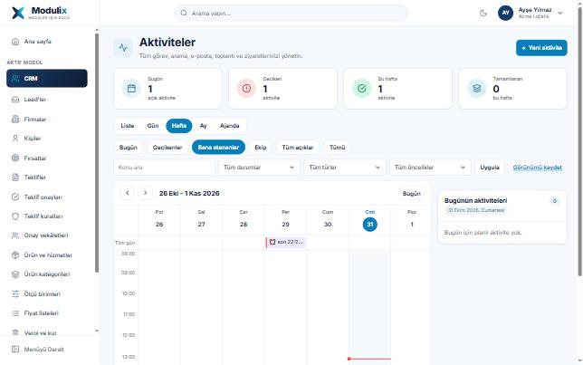
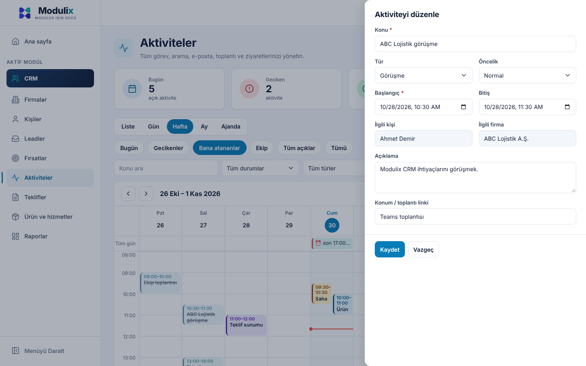
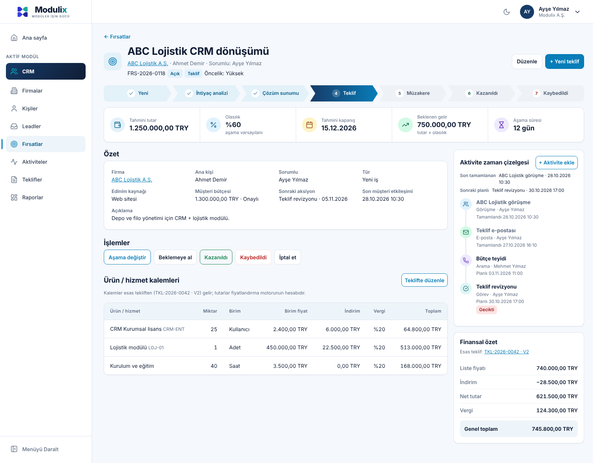
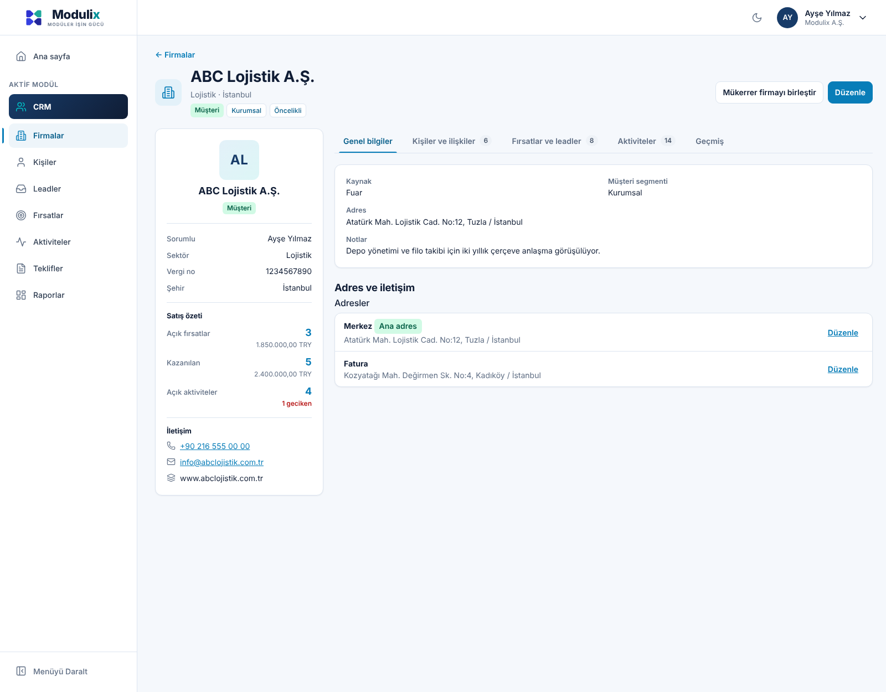
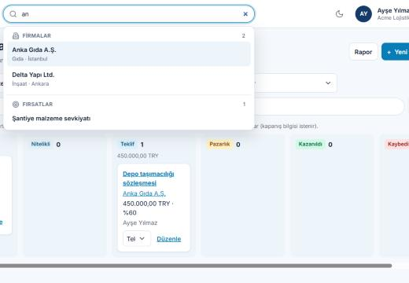
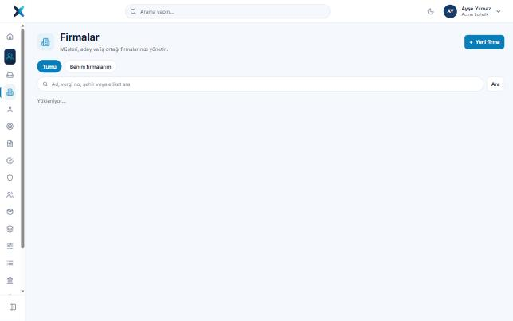
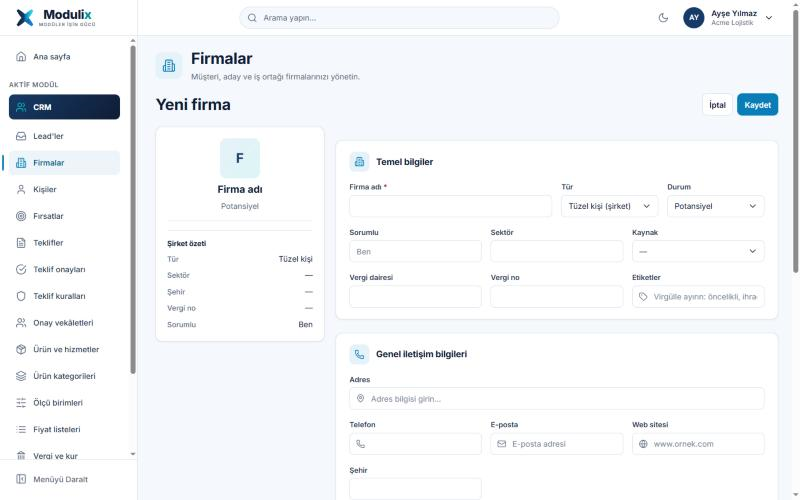
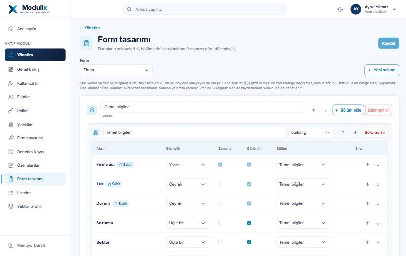
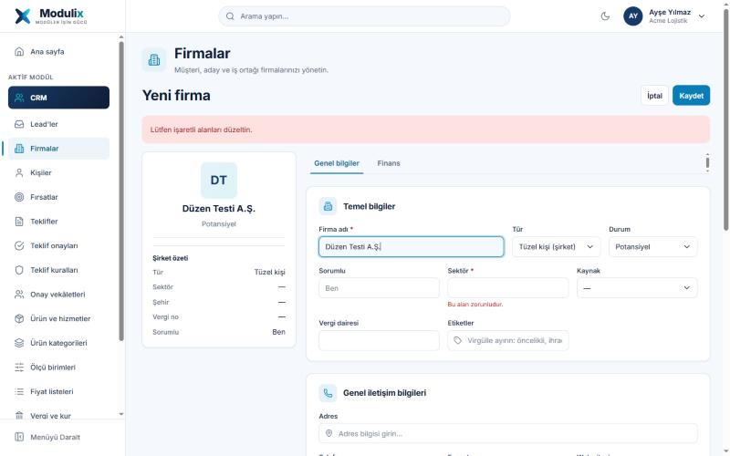
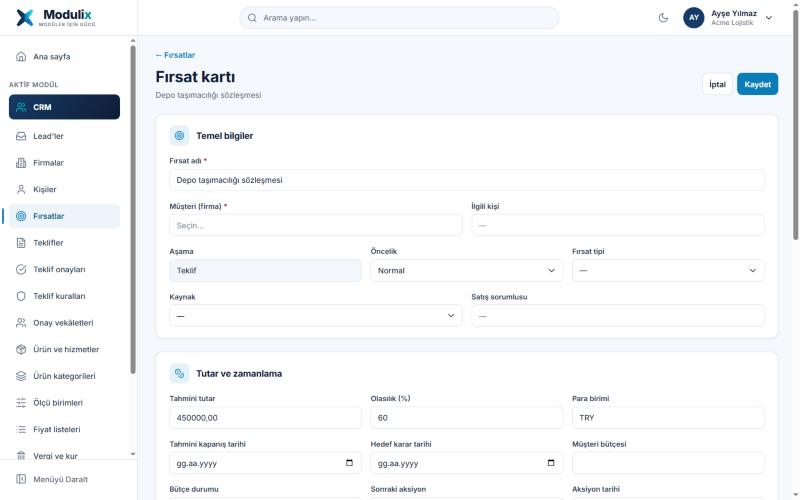

# Tasarım sistemi geçiş raporu — Faz 1

Tarih: 30.10.2026 · Dal: `tasarim-sistemi/faz-1`

Bu faz, Modulix tasarım sistemini **merkezi katmanlardan** (token, tema, kabuk, ortak CSS) kurar. Bütün sayfalar aynı ortak sınıfları kullandığı için yeni görünüm tek noktadan bütün ekranlara yansır. Ekrana özel yeniden düzenlemeler (fırsat hunisi, aktivite çekmecesi, DataGrid gibi) sonraki fazlara bırakıldı; aşağıda açıkça listelendi.

> Önizlemeler gerçek `app.css` ve layout CSS'iyle hazırlanmış statik bir HTML sayfasından alınmıştır (uygulama veritabanı olmadan bu ortamda çalıştırılamadı). Tablo ve sayılar örnek veridir.

## 1. Mevcut altyapı (envanter)

| Konu | Bulgu |
|---|---|
| Framework | .NET 10, Blazor WebAssembly (standalone), `Modulix.Web` yalnızca `Modulix.Shared`'a başvurur |
| UI kütüphanesi | Bootstrap 5.3.3 (yerel `wwwroot/lib`), ek bileşen kütüphanesi yok |
| Stil | `wwwroot/css/app.css` (~2.300 satır, `--mx-*` değişkenleri) + scoped `*.razor.css` (MainLayout, NavMenu) |
| Routing | `@page` yönlendirmeleri, Türkçe slug'lar; aktif modül route'tan `AppNavigation.Resolve` ile bulunur |
| Layout / navigation | `MainLayout`, `NavMenu`, `AppLauncher` (uygulama paneli), `PublicLayout` (oturumsuz teklif sayfası) |
| Form altyapısı | Elle yazılmış formlar (`record-form`, `form-grid`), `FieldError`, sunucu doğrulaması |
| Dinamik alanlar | `CustomFieldInputs` (özel alanlar), `Yönetim → Özel alanlar`, `Seçim listeleri` |
| Lookup | `LookupPicker` + `js/lookup.js`, aranabilir alanlar `Alan ve lookup ayarları` ekranından (metadata) |
| Grid | `table record-table` + `Pager`; telefonda kart listesi |
| Modal / drawer / toast | Yok; sayfa içi formlar ve `Notice` |
| Dashboard / grafik | `Home` istatistik kartları, `BarChart`, `DonutChart`, rapor sayfaları |
| Tema / tercih | Yoktu (bu fazda eklendi) |
| Tenant / platform ekranları | `Pages/Admin` (14), `Pages/Platform` (6) |

## 2. Ekran envanteri

57 Razor sayfası var. **Referans tasarımdaki Sözleşmeler, Siparişler, Destek Talepleri, Şikâyet, Onboarding, CRM Dashboard, Workflow, Entegrasyon, Form/View Designer ekranları uygulamada yoktur** ve raporda varmış gibi gösterilmez.

| Grup | Sayfalar | Ortak desen | Bu fazda |
|---|---|---|---|
| Kimlik (oturumsuz) | Giriş, Şifremi unuttum, Şifre sıfırla, E-posta onayı, Davet, Kuruluş seç | `narrow` kart | Token/tema, marka adı |
| Genel | Ana sayfa, Hesabım, Bulunamadı | `stat-card`, `settings-group` | Token/tema |
| CRM — liste | Firmalar, Kişiler, Leadler, Fırsatlar, Aktiviteler, Teklifler, Ürünler, Fiyat listeleri, Kategoriler, Birimler, İndirimler, Teklif kuralları, Onaylar, Vekâletler, Lead formları, Vergi ve kur | `page-header`, `filters`, `record-table`, `Pager` | Token/tema; **PageHeader** Firmalar, Kişiler, Fırsatlar, Aktiviteler |
| CRM — detay | Firma, Kişi, Lead, Fırsat, Teklif, Teklif karşılaştır, Firma/Kişi birleştir | `detail-section`, `summary`, `board`, `item-list` | Token/tema |
| CRM — rapor/araç | Fırsat raporu, Teklif raporu, Fiyat hesapla | `chart-card`, `record-table` | Token/tema, grafik renkleri |
| CRM — dış | Paylaşılan teklif (`/teklif/{tenant}`) | `PublicLayout` | Marka adı |
| Yönetim | Ana sayfa, Kullanıcılar (+detay), Roller (+detay), Ekipler (+detay), Şirketler, Özel alanlar, Seçim listeleri, Alan ve lookup ayarları, Sektör profili, Ayarlar, Denetim kaydı | `page-header`, `record-table`, `permission-matrix` | Token/tema |
| Platform | Ana sayfa, Firmalar (+detay), Modül hakları, Katalog, Olaylar | `record-table`, `tile` | Token/tema |

## 3. Sonuç tablosu

| Alan | Durum | Değiştirilen dosyalar | Test sonucu | Eksikler |
|---|---|---|---|---|
| Design Tokens | Tamam | `wwwroot/css/app.css` | Kontrast hesabı: bütün metin çiftleri AA; statik önizleme | — |
| AppShell | Tamam | `Layout/MainLayout.razor(.css)`, `Components/ThemeToggle.razor`, `wwwroot/js/shell.js`, `wwwroot/index.html` | CI derleme ✓; statik önizleme (1440/390px) | Global arama, bildirim merkezi, yardım (altyapı yok) |
| Navigation | Tamam | `Layout/NavMenu.razor(.css)`, `Components/AppLauncher.razor`, `Components/AppIcon.razor`, `Components/BrandLogo.razor` | Statik önizleme (açık, koyu, daraltılmış) | Menü bugün yalnızca aktif modülün sayfalarını gösterir (mevcut davranış korundu) |
| Form Components | Kısmen | `app.css` (form durumları, `required`, `aria-invalid`) | Önizlemede default/invalid/read-only/disabled | Ayrı Razor bileşenleri (TextField vb.), FileUpload, RichText, kaydedilmemiş değişiklik uyarısı, Kaydet ve Kapat/Yeni |
| DataGrid | Kısmen | `app.css` (`record-table`) | Önizleme; telefonda kart listesi | Kolon görünürlüğü/yeniden boyutlandırma, kayıtlı görünüm, dışa aktarma, ortak bileşen |
| Firma/Kişi | Tamam (faz 4) | `Pages/Crm/CompanyDetail.razor`, `ContactDetail.razor`, `Components/TabBar.razor`, `TabState.cs` | CI çalışma 41158356211 ✓ (derleme + 817 test); statik önizleme | Liste ekranları PageHeader + token düzeyinde; düzenleme formu (CompanyEditor/ContactEditor) tam sayfa olarak kaldı |
| Aktiviteler | Tamam (faz 2) | `Pages/Crm/Activities.razor`, `Components/ActivityCalendar.razor`, `Components/TodayActivities.razor`, `Components/Drawer.razor`, `Services/ActivityLabels.cs` | CI çalışma 41128200581 ✓ (derleme + 817 test); statik önizleme | Saat çizelgesinde blok sürükleyerek saat değiştirme ve yeniden boyutlandırma yok (gün değiştirme var); detay çekmecesinde ayrı sekmeler yok |
| Fırsatlar | Tamam (faz 3) | `Pages/Crm/OpportunityDetail.razor`, `Components/SalesPipeline.razor` | CI çalışma 41156483217 ✓ (derleme + 817 test, yeniden çalıştırmada); statik önizleme | Fırsat listesi/pano ekranı yalnızca token/tema düzeyinde |
| Teklifler | Token/tema | — | — | Detay düzeni |
| Diğer CRM | Token/tema | Bütün `PageTitle` metinleri | — | — |
| Yönetim | Token/tema | — | — | Ekrana özel düzen |
| Dinamik Formlar | Token/tema | — (aynı sınıflar) | — | Form/View Designer ekranları yok |
| Dark Mode | Tamam | `app.css` (`[data-theme=dark]`), `shell.js`, `ThemeToggle` | Önizleme; kontrast hesabı AA | Platform/tenant tema politikası yok |
| Responsive | Tamam (kabuk) | MainLayout/NavMenu CSS | 390px'te uygulama CSS'inden yatay taşma yok | Ekran bazında doğrulama |
| Accessibility | Kısmen | "İçeriğe geç", görünür odak, `aria-expanded/pressed`, durum metinleri | Kontrast hesabı | Otomatik a11y testi (axe) altyapısı yok |

## 4. Test sonuçları

- **CI (GitHub Actions, `workflow_dispatch`, dal `tasarim-sistemi/faz-1`, çalışma 41125845293): başarılı.** Release derleme (null uyarıları hata), migration ve bütün testler geçti: mimari 29/29, Core 211/211, CRM 206/206, entegrasyon (gerçek SQL Server) 371/371. Bu oturumda NuGet erişimi olmadığı için derleme yerelde değil CI'da yapıldı.
- Değişiklikler yalnızca `Modulix.Web` arayüz katmanındadır; API, iş kuralları, veritabanı, yetki ve tenant süzgeçleri değişmedi. Arayüz için otomatik bileşen testi (bUnit) altyapısı yoktur; kabuk davranışı statik önizlemeyle kontrol edildi, gerçek tarayıcıda elle denenmelidir.
- **Görsel kontrol**: gerçek CSS dosyalarıyla statik önizleme Playwright/Chromium'da açık, koyu, daraltılmış menü ve 390px mobil olarak çekildi.
- **Kontrast**: 21 renk çifti hesaplandı. Referanstaki `#64748B` sayfa zemininde 4.47:1 ve aktif menü metni 4.12:1 çıktı; ikisi düzeltildi, şimdi hepsi ≥ 4.5:1 (logo "x" büyük metin, 3.9:1).
- **Palet düzeltmesi (31.10.2026)**: Faz 1'in referans tasarımdan aldığı lacivert/mavi palet, ürün kararı olan Modulix varsayılanıyla (lacivert / indigo / turkuaz / lila / krem; yol haritası K6, Ç15a.1) değiştirildi; yazı tipi Public Sans'a döndü. Yalnızca token değerleri ve `index.html` değişti; bileşenler ve düzenler aynı. Açık/koyu temada bütün metin çiftleri yeniden hesaplandı, hepsi AA (logo "x" büyük metin 4.0:1). Güncel değerler `theme-tokens.md`'de. Bu klasördeki `onizleme-*.png` görüntüleri önceki paletle alınmıştır; düzenler aynıdır, yalnızca renkler farklıdır.

## 5. Bilinçli olarak değiştirilmeyenler

- Sunucu tarafındaki "Modülix" metinleri (e-posta konu ve gövdeleri, `EmailOptions.FromName`, denetim kaydındaki "Modülix platform yöneticisi" adı, teklif PDF meta verisi `ModüliX`). Denetim adı kayıtlara yazılan veridir ve testler ona dayanır; e-posta metinleri ayrı bir kararla değiştirilmelidir.
- Logo işareti (`modulix-mark.svg`): onaylı varlık korundu, yeni logo üretilmedi. Renkleri eski paletten geliyor; yeni paletle güncellenmiş bir işaret tasarım ekibinden gelirse yalnızca dosya değişir.

## 6. Sonraki fazlar (önerilen sıra)

1. Ortak Razor bileşenleri: `Card`, `KpiCard`, `StatusBadge`, `EmptyState`, `Toast` (merkezi), `ConfirmDialog`, `Drawer`.
2. `DataGrid` bileşeni (mevcut `record-table` + `Pager` + `filters` desenini sarar; kolon görünürlüğü, kayıtlı görünüm).
3. Aktiviteler: KPI kartları, haftalık saat çizelgesi, Bugünün aktiviteleri paneli, detay çekmecesi (`ActivityEditor` çekmece içinde).
4. Fırsat detayı: chevron huni, KPI şeridi, sağ panel.
5. Firma/Kişi detay düzeni (ana içerik + sağ özet), ardından Teklif ve Yönetim ekranları.
6. Kaydedilmemiş değişiklik uyarısı, "Kaydet ve Kapat / Yeni".
7. bUnit ile bileşen testleri ve Playwright + axe ile görsel/erişilebilirlik regresyonu (test projesi eklemek mimari kural tablosunu günceller).

## Faz 2 — Aktiviteler ekranı

| Özellik | Durum | Not |
|---|---|---|
| PageHeader + "Yeni aktivite" | Var | |
| Özet kartları (Bugün, Geciken, Bu hafta, Tamamlanan) | Var | Her kart, sayısını verdiği görünümü açar. Sayılar mevcut liste uç noktasından `pageSize=1` + `TotalCount` ile gelir; yeni uç nokta yok. Kapsam kullanıcıya atananlardır |
| Görünümler | Var | Liste, Gün, Hafta, Ay, Ajanda. **Varsayılan görünüm Liste'den Hafta'ya alındı** (referans tasarım); kayıtlı görünümler aynen çalışır |
| Saat çizelgesi (hafta/gün) | Var | Varsayılan 08–18, daha erken/geç aktivite varsa genişler; çakışanlar yan yana; tüm gün ve yalnızca son tarihli işler üst satırda; bugün sütunu ve şimdiki zaman çizgisi; firma saat dilimi |
| Türe göre renk | Var | Aile (görev, arama, toplantı, ziyaret, e-posta) → ton; gecikmiş kırmızı çizgi + "gecikti" metni |
| Sürükle-bırak | Korundu | Başka güne taşıma (saat korunur), sunucu yetki ve çakışmayı denetler; çakışmada "yine de taşı" |
| Bugünün aktiviteleri paneli | Var | Takvimin sağında (≥1200px), dar ekranda altında; ikon, saat, konu, kişi, firma, tür, durum |
| Detay / düzenleme çekmecesi | Var | `ActivityActions` ve `ActivityEditor` sağdan açılır; telefonda tam ekran |
| Tekrarlayan aktivite, hatırlatıcı sekmesi | Yok | Altyapıda yok |

## Faz 3 — Fırsat detayı

| Özellik | Durum | Not |
|---|---|---|
| Başlık | Var | İkon, ad, firma · kişi · sorumlu, durum/aşama rozetleri, uyarılar; Düzenle ve Yeni teklif |
| Satış hunisi (chevron) | Var | `SalesPipeline`: aşamalar tenant'ın aşama listesinden gelir (sıra/kategori yönetici ayarı, kod içinde sabit aşama yok). Geçilen aşamalar onaylı, güncel aşama dolu, kazanıldı/kaybedildi kendi tonunda. Aşamaya tıklamak **işlem panelini açar** (Aşama değiştir / Kazanıldı / Kaybedildi) ve ilk alana odaklanır; aşama kuralları ve doğrulamalar mevcut işlemle sunucuda çalışır. Telefonda yalnızca güncel aşama adıyla görünür |
| Gösterge şeridi | Var | Tahmini tutar, Olasılık, Tahmini kapanış, Beklenen gelir (mevcut ağırlıklı tutar hesabı), Aşama süresi. Tutar göstergeleri alan yetkisine (`crm.opportunities.amounts.read`) bağlıdır |
| İki kolonlu düzen | Var | ≥1200px ana içerik + yapışkan sağ panel; dar ekranda alt alta |
| Ürün / hizmet kalemleri | Var (salt okunur) | Fırsatın kendi kalemi yoktur; **esas teklifin** kalemleri fiyatlandırma motorunun hesaplarıyla gösterilir, düzenleme teklif ekranındadır ("Teklifte düzenle"). Esas teklif yoksa bölüm görünmez |
| Aktivite zaman çizelgesi | Var | Aile ikon ve rengiyle dikey çizelge; "Aktivite ekle" sağdan açılan panelde |
| Finansal özet | Var | Esas teklifin liste fiyatı, indirim, net, vergi, genel toplam (para birimi teklifinki); esas teklif yoksa elle girilen tahmini tutar |
| Karar vericiler / rakipler | Korundu | Mevcut kişi rolleri ve rakip bölümleri aynen; ilişkisel lookup (`LookupPicker`) kullanılıyor |
| Takip et | Yok | Altyapıda takip/abonelik yok |

**CI notu (faz 3):** İlk çalıştırmada `PlatformAdministrationTests.Failed_opening_creates_nothing_and_sends_no_email` son adımda 201 yerine 500 döndü. Bu faz yalnızca `Modulix.Web`, README ve belgeleri değiştirdi; aynı test önceki iki çalışmada geçmişti ve yalnızca başarısız iş yeniden çalıştırılınca bütün testler geçti. Test kararsızdır (flaky); ayrı bir iş kalemi olarak incelenmelidir (aynı kısa adla ikinci tenant açılışı sırasında sunucu hatası). PR #77 çalışmasında da `EventTests.Concurrent_dispatchers_complete_each_delivery_once` bir kez SQL Server deadlock'u ile kırıldı, yeniden çalıştırmada geçti.

## Faz 4 — Firma ve kişi detayı

| Özellik | Durum | Not |
|---|---|---|
| Başlık | Var | İkon, ad, sektör · şehir (kişide unvan · birincil firma), durum ve etiket rozetleri; Birleştir + Düzenle |
| Özet kartı (solda, yapışkan) | Var | Avatar (baş harfler), sorumlu, sektör, vergi no, şehir; firma için satış özeti (açık/kazanılan fırsat sayısı ve toplamları, açık/geciken aktivite — sunucudaki özet uç noktası); hızlı iletişim (telefon, e-posta, web). Telefonda kimlik bloğu gizlenir (başlıkta zaten var) |
| Sekmeler | Var | Firma: Genel bilgiler (kaynak, adres, notlar, özel alanlar, adres ve iletişim, lokasyonlar) · Kişiler ve ilişkiler · Fırsatlar ve leadler · Aktiviteler · Geçmiş. Kişi: Genel bilgiler · Firma ilişkileri · Aktiviteler · Fırsatlar ve leadler · Geçmiş. Yetkisiz bölüm sekme olarak görünmez |
| Sekme davranışı | Var | İlk seçilişte yüklenir, sonra gizli kalır (kaydedilmemiş değişiklik kaybolmaz); sayı rozetleri |
| Aktivite / fırsat ekleme | Var | Firma sayfasında sağdan açılan panelde |
| Referanstaki "Finansal Durum & Cari" sekmesi | Yok | Kredi limiti, cari bakiye, e-fatura durumu gibi alanlar veri modelinde yok; gerekiyorsa özel alan (metadata) ya da ayrı bir finans modülü işi |

## Gerçek tarayıcıda ekran testi (31.10.2026)

GitHub Actions üzerinde gerçek ortamda çalıştırıldı: SQL Server + migration + örnek veri (`seed`), uygulama HTTPS'te, Chromium (Playwright) ile 1440px ve 390px. Betik ve geçici iş akışı `e2e/ekran-testi` dalındadır (main'e birleştirilmez); ekran görüntüleri ve ayrıntılı tablo o daldaki `ekran-testi-sonuc/` klasöründe.

**Sonuç: 41/41 kontrol geçti** (giriş, kabuk, Aktiviteler, Fırsat, Firma, Kişi, koyu tema, mobil, Blazor hata çubuğu).

Test sırasında bulunup bu dalda düzeltilenler:

| Bulgu | Neden | Düzeltme |
|---|---|---|
| Aktivite detayında tür ham anahtar ("Meeting"), sorumlu "—"; aktivite durumu aileye göre değil genel adla | `CrmLookups` geçici (transient) kayıtlı; `ActivityActions` kendisi enjekte edince boş örnek alıyordu (tasarım fazlarından önce de vardı) | Sayfanın yüklediği örnek parametreyle verilir |
| Lead raporunda kaynak, diskalifiye nedeni ve sorumlu adları ham anahtar | Aynı neden (`LeadReportPanel`) | Aynı düzeltme |
| Aktiviteler süzgeç satırında her alan tam genişlikte, alt alta | Bootstrap `form-control` genişliği | `.filters` içindeki alanlar yan yana |
| Telefonda haftalık çizelgede bugün ekran dışında | 7 sütun 390px'e sığmaz | Telefonda varsayılan görünüm Gün |

Kalan gözlem: telefonda Fırsat sayfasının sağ paneli (aktivite zaman çizelgesi, finansal özet) en alta, değişiklik geçmişinin altına düşüyor; hata değil, sıralama iyileştirmesi olarak sonraki işe bırakıldı. `QuoteSharingPanel` ve `RelatedLeads` da `CrmLookups` enjekte ediyor ama kullanmıyor (zararsız).

## Faz 5 — Palet, logo ve genel arama (31.10.2026)

Dal: `gseker/modulix-design-system-0f1c04`. Kullanıcı kararı: tasarım sistemi **referans CRM ekranlarının lacivert / mavi / turkuaz paletine** göre uygulanır; aynı gün erken saatte yapılan indigo / lila / krem dönüşü (PR #79) geri alındı ve yol haritasındaki K6 / Ç15a.1 maddeleri bu karara göre düzeltildi (bir daha "ürün varsayılanı" gerekçesiyle geri dönülmesin diye).

| Özellik | Durum | Not |
|---|---|---|
| Renk tokenları | Değişti | Şablondaki 15 token birebir (`brand-navy #101D35`, `brand-navy-light #173B68`, `brand-primary #087DB8`, `brand-teal #00C2C7`, `brand-teal-dark #008F98`, `background #F5F8FC`, `surface-muted #EEF5FA`, `border #DCE5F0`, durum renkleri). Yalnızca `text-secondary` için şablondaki `#64748B` yerine `#5D6B81` kullanıldı (sayfa zemininde 4.47:1 → 5.1:1). Marka ve turkuaz ton çiftleri, grafik serileri ve gölgeler yeni palete göre; koyu tema aynı adlarla koyu lacivert zemin üzerine yeniden türetildi |
| Tipografi | Değişti | Inter (Google Fonts, 400–800); önceki Public Sans kaldırıldı |
| Logo | Değişti | `modulix-mark.svg` referans logoya göre yeniden çizildi: iki çapraz, eğik uçlu şeritten oluşan "X" (sol yarı lacivert, sağ üst turkuaz, sağ alt mavi; "/" şeridi üstte); koyu tema için `modulix-mark-dark.svg` eklendi ve `BrandLogo` temaya göre birini gösterir; `favicon.png` (64px) ve `icon-192.png` aynı geometriden üretildi; `theme-color` `#101D35`. Logo metni `BrandLogo` bileşeninde "Moduli" + turkuaz "x", slogan MODÜLER İŞİN GÜCÜ (değişmedi) |
| Genel arama | Yeni | `Components/GlobalSearch.razor` üst çubuğun ortasında ("Arama yapın..."). 2+ karakterde 300ms gecikmeyle firma, kişi, fırsat, lead ve teklif liste uç noktalarını yalnızca izin olan türler için paralel çağırır (`pageSize=5`); sonuçlar gruplu panelde, klavye ile gezilir, Enter kaydı açar. Yeni uç nokta yok: tenant, yetki ve kapsam süzgeçleri sunucudaki liste uç noktalarındadır |
| Bildirim ve yardım ikonları | Yok | Bildirim altyapısı ve yardım içeriği yok; sahte ikon eklenmedi |

Bileşenler, düzenler ve davranışlar (faz 2–4) değişmedi; yeni palet token katmanından bütün ekranlara yansır.

**Doğrulama (yerel, gerçek uygulama):** Release derleme 0 hata; mimari testler 29/29. Uygulama yerel SQL Server ve `seed` verisiyle çalıştırıldı, Chromium'da (1440px ve 390px) kontrol edildi: giriş, ana sayfa, Aktiviteler (hafta/gün), Fırsat detayı (huni, gösterge şeridi, sağ panel), Firma detayı (özet kartı, sekmeler), koyu tema, daraltılmış menü (yalnızca işaret), telefonda yatay taşma yok (`scrollWidth == innerWidth`), yazı tipi Inter ve `--mx-brand-primary #087DB8` tarayıcıda doğrulandı. Genel arama: "an" → Firmalar (2) + Fırsatlar (1) gruplu sonuç, Enter ile ilk sonuç (Anka Gıda A.Ş.) açıldı, sonuçsuz sorguda "sonuç bulunamadı", telefonda panel tam genişlikte. Bu klasördeki `onizleme-*.png` görüntüleri bu çalıştırmadan alınmıştır (tarayıcı paneli çözünürlüğünde; `onizleme-aktivite-cekmece.png` önceki paletten kalmadır, düzen aynıdır). Entegrasyon testleri bu oturumda çalıştırılmadı; yalnızca `Modulix.Web` ve belgeler değişti, API ve veritabanı aynı — CI sonucu PR'da.

**Kalanlar:** Üst çubukta bildirim ve yardım ikonları (altyapı yok). Şablondaki "Takip Et", tekrarlayan aktivite, hatırlatıcı sekmesi, DataGrid kolon yönetimi ve kayıtlı görünüm, merkezi toast, modal, bUnit/axe testleri önceki fazlardaki gibi açık iş kalemleridir.

## Faz 6 — Form düzeni: bölüm kartları (31.10.2026)

Kullanıcı geri bildirimi: form ekranları referans görsellerdeki (Firma kartı, Fırsat) kartlı düzenle eşleşmiyordu — editörler tek bir kartta alt alta alan listesiydi. Bu fazda ortak `FormSection` bileşeni ve 12 kolonlu `form-grid` kuruldu; bütün CRM editörleri ve detay bölümleri buna geçirildi. Alanlar, doğrulama, kaydetme ve yetki davranışı değişmedi (yalnızca işaretleme ve CSS).

| Ekran | Durum | Not |
|---|---|---|
| `FormSection` bileşeni | Yeni | İkon kutusu + başlık + açıklama + sağda aksiyon; gövdede `form-grid` ya da `detail-grid`. Çekmecede çerçevesiz, çizgiyle ayrılır |
| `form-grid` | Değişti | 12 kolon; `span-3/4/6/8/12` genişlikleri. Eski kullanım (sınıfsız alan, `span-all`) aynı görünümü korur: 768px üstünde 2, 1200px üstünde 3 kolon |
| Firma formu (`CompanyEditor`) | Değişti | Üstte "Firma kartı" + İptal / Kaydet; solda canlı **Şirket özeti** (baş harfler, ad, durum, tür, sektör, şehir, vergi no, sorumlu); kartlar: Temel bilgiler, Genel iletişim bilgileri (ikonlu adres / telefon / e-posta / web alanları), Notlar ve ek bilgiler. Referanstaki Finans (kredi limiti, cari bakiye, e-fatura) ve Ticari unvan / çalışan sayısı / yıllık gelir alanları veri modelinde yok; şema yalnızca tasarım için değiştirilmedi (özel alan olarak tanımlanabilir) |
| Kişi formu (`ContactEditor`) | Değişti | Kişi kartı + özet (baş harfler, ad soyad, unvan, firma, sorumlu, iletişim); kartlar: Kişi bilgileri, İletişim, Notlar ve ek bilgiler |
| Fırsat formu (`OpportunityEditor`) | Değişti | Kartlar: Temel bilgiler (fırsat adı, müşteri, ilgili kişi, aşama, öncelik, fırsat tipi, kaynak, satış sorumlusu), Tutar ve zamanlama, Detaylar (ihtiyaç analizi — önceden kapalı `details` idi, artık açık kart), Açıklama ve notlar. Çekmecede (firma detayından) aynı bileşen |
| Lead formu (`LeadEditor`) | Değişti | Kartlar: Talep, Talep sahibi, Eşleştirme ve sahiplik, Bütçe ve zamanlama, İhtiyaç ve açıklama; eşleşme uyarısı ve "Yine de kaydet" korunur |
| Aktivite formu (`ActivityEditor`) | Değişti | Kartlar: Aktivite, Zaman, İlişkili kayıtlar, Yer ve ayrıntılar; çekmecede çizgiyle ayrılmış bölümler |
| Fırsat detayı | Değişti | Özet → **Temel bilgiler** kartı; İhtiyaç analizi → **Detaylar**; Ürün / hizmet kalemleri, Kişiler, Rakipler, Teklifler, Aşama ve durum tarihçesi ve sağ paneldeki Aktivite zaman çizelgesi / Finansal özet kartları `FormSection` ile (aksiyon düğmeleri başlıkta) |
| Firma / Kişi detayı | Değişti | Genel sekmesinde Genel bilgiler ve Adres ve iletişim / İletişim bilgileri kartları |
| Lead detayı | Değişti | Talep bilgileri ve Kaynak ve sahiplik kartları |
| Fırsat detayı sekmeleri | Var | `TabBar` + `TabState` ile **Genel bilgiler** (temel bilgiler, işlemler, detaylar, kalemler) · **Kişiler** · **Rakipler** · **Teklifler** (teklif izni yoksa sekme hiç eklenmez) · **Geçmiş** (aşama tarihçesi + değişiklik geçmişi); sayı rozetleri yüklenen listelerden. Sağ panel (aktivite zaman çizelgesi, finansal özet) her sekmede görünür |
| Takip Et, Kazanma nedenleri / Kaybetme riskleri onay kutuları, Notlar / Dokümanlar / Analiz sekmeleri | Yok | Referanstaki bu alanlar ve içerikler veri modelinde / altyapıda yok |

## Faz 7 — Form tasarımı: firmaya göre düzenlenebilir formlar (31.10.2026, ADR-0021)

Kullanıcı isteği: her form için yöneticiye özel özelleştirme — alanların yeri, yeni sekme, zorunluluk gibi özellikler tenant yöneticisince belirlenebilmeli. Form düzeni artık metadata'dır: modül varsayılanı tanımlar (`IModule.Forms` / `CrmForms`), firma `Yönetim → Form tasarımı` ekranından özelleştirir (`meta.FormLayouts`, RLS), editörler `LayoutForm` ile çizer. Firmanın zorunlu kıldığı alan kayıt boru hattında sunucuda denetlenir.

| Ekran | Durum | Not |
|---|---|---|
| Form tasarımı (yönetim) | Yeni | Form seçimi; sekme ekle/sil/sırala/adlandır; bölüm ekle/sil/sırala, ikon, sekmesini değiştir; alan: genişlik, zorunlu, görünür, bölüme taşı, sırala; sabit alanlar rozetli ve kilitli; Kaydet (sürümlü, 409/422 iletileri), Varsayılana dön |
| Firma, Kişi, Fırsat, Lead, Aktivite formları | Değişti | Yerleşim düzenden; birden fazla sekme varsa `TabBar`; bölüm kartları, genişlik ve yıldız düzenden; alan girdileri editörde anahtara göre |
| Özel alanlar | Değişti | Düzende `custom.{anahtar}` olarak taşınabilir; zorunluluk artırılabilir; `Ek bilgiler` varsayılan bölümü |
| Sunucu | Yeni | `GET /api/form-layouts`, `GET/PUT/DELETE /api/customization/form-layouts/{kayıtTürü}`; boru hattında `RecordRequiredFields`; denetim kaydı `core.form-layout` |

**Doğrulama:** Release derleme 0 hata; mimari 29/29; birim 214/214 (yeni `FormLayoutRulesTests`); entegrasyon `FormLayoutTests` 4/4 (mutlu yol + denetim kaydı, doğrulama hataları, tenant izolasyonu, yetki ve sunucuda zorunlu alan denetimi). Gerçek uygulamada: Sektör zorunlu kılındı, Finans sekmesi ve Finansal bilgiler bölümü açıldı, Vergi no oraya taşındı, kaydedildi; Yeni firma formu iki sekmeyle açıldı, sektörsüz kayıt sunucu iletisiyle ("Bu alan zorunludur.") reddedildi; Varsayılana dön çalıştı.

**Yapılmayanlar:** alan ekleme (Özel alanlar ekranının işi), rol/şirket başına düzen, koşullu görünürlük, etiket değiştirme, sürükle-bırak, detay sayfalarının düzeni, teklif ve yönetim formları için tanım (altyapı hazır).

**Doğrulama:** Release derleme 0 hata; mimari testler 29/29. Gerçek uygulamada (Chromium, 1440px ve 390px): Yeni firma, Yeni kişi, Yeni Lead formları, Fırsat düzenleme formu, Aktivite çekmecesi, Fırsat detayı kartları; telefonda yatay taşma yok, özet kartı gizlenir, alanlar tek kolon. Form gönderimi ve doğrulama kodu değişmediği için işlevsel akışlar önceki fazlardaki gibi; entegrasyon testleri CI'da.
